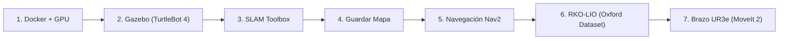

# Guía de Ejecución - Práctica 1 (Robótica Inteligente)

Esta guía describe el flujo de despliegue y ejecución de los bloques de la práctica en el entorno de simulación (**Gazebo Harmonic**), visualización (**RViz2**), mapeado (**SLAM**), navegación autónoma (**Nav2**), odometría LiDAR-inercial (**RKO-LIO**) y manipulación robótica (**MoveIt 2**).

---

## Resumen del Flujo de Trabajo



---

## 1. Preparación y Arranque del Contenedor

### 1.1. Construcción de la imagen
```bash
docker build -t robotica_inteligente_grado:latest .
```

### 1.2. Habilitar servidor X11 y arrancar el contenedor
Ejecutar en la terminal del host:
```bash
xhost +local:docker

docker run -d \
  --user developer \
  --network host \
  --ipc host \
  --pid host \
  --env DISPLAY=$DISPLAY \
  --env QT_X11_NO_MITSHM=1 \
  --env NVIDIA_VISIBLE_DEVICES=all \
  --env NVIDIA_DRIVER_CAPABILITIES=all \
  --env __NV_PRIME_RENDER_OFFLOAD=1 \
  --env __GLX_VENDOR_LIBRARY_NAME=nvidia \
  --volume /tmp/.X11-unix:/tmp/.X11-unix:rw \
  --volume ~/ros2_ws:/home/developer/ros2_ws:rw \
  --device /dev/dri \
  --gpus all \
  --runtime nvidia \
  --name robotica_inteligente_grado \
  robotica_inteligente_grado:latest \
  sleep infinity
```

---

## 2. Bloque 2 - Fase de Mapeo (SLAM)

Abrir terminales independientes o utilizar `docker exec`:

### Terminal 1: Simulador Gazebo (Almacén Warehouse)
```bash
docker exec -it --user developer robotica_inteligente_grado bash -c \
  "source /opt/ros/jazzy/setup.bash && ros2 launch turtlebot4_gz_bringup turtlebot4_gz.launch.py"
```

### Terminal 2: Algoritmo SLAM
```bash
docker exec -it --user developer robotica_inteligente_grado bash -c \
  "source /opt/ros/jazzy/setup.bash && ros2 launch turtlebot4_navigation slam.launch.py use_sim_time:=true"
```

### Terminal 3: Visualizador RViz2
```bash
docker exec -it --user developer robotica_inteligente_grado bash -c \
  "source /opt/ros/jazzy/setup.bash && ros2 launch turtlebot4_viz view_navigation.launch.py use_sim_time:=true"
```

### Terminal 4: Teleoperación por teclado
```bash
docker exec -it --user developer robotica_inteligente_grado bash -c \
  "source /opt/ros/jazzy/setup.bash && ros2 run teleop_twist_keyboard teleop_twist_keyboard --ros-args -r /cmd_vel:=/cmd_vel_unstamped"
```

#### Controles:
- `i` / `,`: Avanzar / Retroceder
- `j` / `l`: Giro sobre el eje
- `u` / `o`: Avance con giro
- `k` o `Espacio`: Parada
- `q` / `z`: Modificar velocidad

---

## 3. Guardado del Mapa 2D

Una vez explorado el entorno y completado el mapa en RViz2:
```bash
docker exec -it --user developer robotica_inteligente_grado bash -c \
  "source /opt/ros/jazzy/setup.bash && ros2 run nav2_map_server map_saver_cli -f /home/developer/ros2_ws/mapa_laboratorio"
```
Los ficheros `mapa_laboratorio.yaml` y `mapa_laboratorio.pgm` quedan persistidos en `~/ros2_ws`.

---

## 4. Bloque 2 - Navegación Autónoma (Nav2)

> Detener previamente los procesos de SLAM y Teleoperación.

### Terminal 1: Simulador Gazebo
```bash
docker exec -it --user developer robotica_inteligente_grado bash -c \
  "source /opt/ros/jazzy/setup.bash && ros2 launch turtlebot4_gz_bringup turtlebot4_gz.launch.py"
```

### Terminal 2: Servidor de Mapas y Localización (AMCL)
```bash
docker exec -it --user developer robotica_inteligente_grado bash -c \
  "source /opt/ros/jazzy/setup.bash && ros2 launch turtlebot4_navigation localization.launch.py map:=/home/developer/ros2_ws/mapa_laboratorio.yaml use_sim_time:=true"
```

### Terminal 3: Planificación y Control (Nav2)
```bash
docker exec -it --user developer robotica_inteligente_grado bash -c \
  "source /opt/ros/jazzy/setup.bash && ros2 launch turtlebot4_navigation nav2.launch.py use_sim_time:=true"
```

### Terminal 4: Visualizador RViz2
```bash
docker exec -it --user developer robotica_inteligente_grado bash -c \
  "source /opt/ros/jazzy/setup.bash && ros2 launch turtlebot4_viz view_navigation.launch.py use_sim_time:=true"
```

### Control Programático de Objetivos (Opcional 1)
En lugar de fijar metas manualmente en RViz2:
```bash
docker exec -it --user developer robotica_inteligente_grado bash -c \
  "source /opt/ros/jazzy/setup.bash && python3 /home/developer/ros2_ws/p1_scripts/nav2_send_goal.py --x 2.0 --y 1.5 --yaw 1.57"
```

---

## 5. Bloque 3 - Odometría LiDAR-Inercial (RKO-LIO)

### Terminal 1: Lanzamiento de RKO-LIO
```bash
docker exec -it --user developer robotica_inteligente_grado bash -c \
  "source /opt/ros/jazzy/setup.bash && ros2 launch rko_lio odometry.launch.py initialization_phase:=false rviz:=true config_file:=/home/developer/ros2_ws/oxford_spires.yaml use_sim_time:=true"
```

### Terminal 2: Reproducción del Dataset Real
```bash
docker exec -it --user developer robotica_inteligente_grado bash -c \
  "source /opt/ros/jazzy/setup.bash && cd /home/developer/ros2_ws && ros2 bag play 1710255615_2024-03-12-15-00-16/ --clock"
```

---

## 6. Bloque 4 - Manipulación Robótica (UR3e + MoveIt 2)

### Terminal 1: Simulación Unificada (Gazebo + MoveIt 2 + RViz)
```bash
docker exec -it --user developer robotica_inteligente_grado bash -c \
  "source /opt/ros/jazzy/setup.bash && ros2 launch ur_simulation_gz ur_sim_moveit.launch.py ur_type:=ur3e"
```

### Control Programático de Poses (Opcional 2)
```bash
# Modo articular específico:
docker exec -it --user developer robotica_inteligente_grado bash -c \
  "source /opt/ros/jazzy/setup.bash && python3 /home/developer/ros2_ws/p1_scripts/ur3e_send_pose.py --mode joint --joints 0.0 -1.57 1.57 -1.57 -1.57 0.0"

# Modo cartesiano 3D (cinemática inversa + OMPL):
docker exec -it --user developer robotica_inteligente_grado bash -c \
  "source /opt/ros/jazzy/setup.bash && python3 /home/developer/ros2_ws/p1_scripts/ur3e_send_pose.py --mode cartesian --x 0.25 --y 0.15 --z 0.35"

# Modo poses predefinidas en SRDF (home, up, test_configuration):
docker exec -it --user developer robotica_inteligente_grado bash -c \
  "source /opt/ros/jazzy/setup.bash && python3 /home/developer/ros2_ws/p1_scripts/ur3e_send_pose.py --mode named --named home"
```

### Introspección del Sistema y Extracción de Diagramas
```bash
# Extraer árbol de transformaciones cinemáticas TF:
docker exec -it --user developer robotica_inteligente_grado bash -c \
  "source /opt/ros/jazzy/setup.bash && ros2 run tf2_tools view_frames"

# Visualizar grafo dinámico de nodos y acciones:
docker exec -it --user developer robotica_inteligente_grado bash -c \
  "source /opt/ros/jazzy/setup.bash && ros2 run rqt_graph rqt_graph"
```

> Consulta el informe detallado del Bloque 4 en [reporte_ur3e_moveit_pipeline.md](memoria/reporte_ur3e_moveit_pipeline.md).

---

## 7. Gestión del Contenedor Docker

| Acción | Comando |
| :--- | :--- |
| **Iniciar contenedor detenido** | `docker start robotica_inteligente_grado` |
| **Reiniciar contenedor** | `docker restart robotica_inteligente_grado` |
| **Detener contenedor** | `docker stop robotica_inteligente_grado` |
| **Eliminar contenedor** | `docker rm -f robotica_inteligente_grado` |
| **Entrar de forma interactiva** | `docker exec -it --user developer robotica_inteligente_grado bash` |
