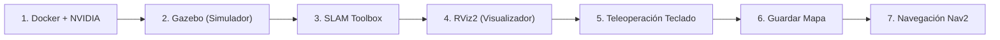

# Guía de Ejecución - Práctica 1 (Robótica Inteligente)

Esta guía describe el flujo paso a paso para desplegar y ejecutar el entorno de simulación (**Gazebo Harmonic**), visualización (**RViz2**), mapeado (**SLAM**) y **navegación autónoma** con aceleración por hardware **NVIDIA GPU**.

---

## 📋 Resumen del Flujo de Trabajo



---

## 🚀 Paso 1: Preparación y Arranque del Contenedor

### 1.1. Construir la imagen (solo la primera vez o si se cambia el Dockerfile)
```bash
cd RI-Practica-1   # O el directorio raíz donde hayas clonado el repositorio
docker build -t robotica_inteligente_grado:latest .
```

### 1.2. Habilitar X11 y arrancar el contenedor con aceleración NVIDIA
Ejecuta en tu terminal del host:
```bash
xhost +local:docker

docker run -d \
  --user developer \
  --network host \
  --ipc host \
  --pid host \
  --env DISPLAY=$DISPLAY \
  --env QT_X11_NO_MITSHM=1 \
  --env NVIDIA_VISIBLE_DEVICES=all \
  --env NVIDIA_DRIVER_CAPABILITIES=all \
  --env __NV_PRIME_RENDER_OFFLOAD=1 \
  --env __GLX_VENDOR_LIBRARY_NAME=nvidia \
  --env __GL_THREADED_OPTIMIZATIONS=0 \
  --volume /tmp/.X11-unix:/tmp/.X11-unix:rw \
  --volume ~/ros2_ws:/home/developer/ros2_ws:rw \
  --device /dev/dri \
  --gpus all \
  --runtime nvidia \
  --name robotica_inteligente_grado \
  robotica_inteligente_grado:latest \
  sleep infinity
```

---

## 🗺️ Paso 2: Fase de Mapeo (SLAM)

Abre terminales independientes en tu sistema o ejecuta los comandos con `docker exec`:

### Terminal 1: Lanzar el simulador Gazebo (Almacén Warehouse)
```bash
docker exec -it --user developer robotica_inteligente_grado bash -c "source /opt/ros/jazzy/setup.bash && ros2 launch turtlebot4_gz_bringup turtlebot4_gz.launch.py"
```

### Terminal 2: Lanzar el algoritmo SLAM
```bash
docker exec -it --user developer robotica_inteligente_grado bash -c "source /opt/ros/jazzy/setup.bash && ros2 launch turtlebot4_navigation slam.launch.py use_sim_time:=true"
```

### Terminal 3: Lanzar RViz2 para ver el mapa en tiempo real
```bash
docker exec -it --user developer robotica_inteligente_grado bash -c "source /opt/ros/jazzy/setup.bash && ros2 launch turtlebot4_viz view_navigation.launch.py use_sim_time:=true"
```

### Terminal 4: Conducir el robot con las teclas (Teleoperación)
```bash
docker exec -it --user developer robotica_inteligente_grado bash -c "source /opt/ros/jazzy/setup.bash && ros2 run teleop_twist_keyboard teleop_twist_keyboard --ros-args -r /cmd_vel:=/cmd_vel_unstamped"
```

#### Controles de Teclado:
- `i`: Avanzar
- `,`: Retroceder
- `j` / `l`: Girar izquierda / derecha
- `u` / `o`: Avanzar girando izquierda / derecha
- `k` o `Espacio`: Detener
- `q` / `z`: Aumentar / reducir velocidad

---

## 💾 Paso 3: Guardar el Mapa

Cuando hayas recorrido el almacén y el mapa en RViz2 esté completo y nítido:
```bash
docker exec -it --user developer robotica_inteligente_grado bash -c "source /opt/ros/jazzy/setup.bash && ros2 run nav2_map_server map_saver_cli -f /home/developer/ros2_ws/mapa_laboratorio"
```
*(Generará `/home/developer/ros2_ws/mapa_laboratorio.yaml` y `.pgm` que persisten en tu carpeta `~/ros2_ws`)*.

---

## 🎯 Paso 4: Fase de Navegación Autónoma (Nav2)

> **Nota:** Antes de iniciar la navegación autónoma, detén los procesos de SLAM y Teleoperación (Ctrl+C en sus terminales).

### Terminal 1: Mantener/Lanzar el simulador Gazebo
```bash
docker exec -it --user developer robotica_inteligente_grado bash -c "source /opt/ros/jazzy/setup.bash && ros2 launch turtlebot4_gz_bringup turtlebot4_gz.launch.py"
```

### Terminal 2: Servidor de Mapas y Localización (AMCL)
```bash
docker exec -it --user developer robotica_inteligente_grado bash -c "source /opt/ros/jazzy/setup.bash && ros2 launch turtlebot4_navigation localization.launch.py map:=/home/developer/ros2_ws/mapa_laboratorio.yaml use_sim_time:=true"
```

### Terminal 3: Motores de Planificación y Control (Nav2)
```bash
docker exec -it --user developer robotica_inteligente_grado bash -c "source /opt/ros/jazzy/setup.bash && ros2 launch turtlebot4_navigation nav2.launch.py use_sim_time:=true"
```

### Terminal 4: Visualizador RViz2
```bash
docker exec -it --user developer robotica_inteligente_grado bash -c "source /opt/ros/jazzy/setup.bash && ros2 launch turtlebot4_viz view_navigation.launch.py use_sim_time:=true"
```

### Interacción en RViz2:
1. Pulsa el botón **2D Pose Estimate** en RViz2 y haz clic/arrastra sobre la posición estimada del robot en Gazebo para sincronizar AMCL.
2. Pulsa **2D Goal Pose** y haz clic en cualquier punto del mapa para que el TurtleBot 4 planifique la ruta y navegue automáticamente evitando obstáculos.

---

## 🛠️ Comandos Rápidos de Gestión de Contenedor

| Acción | Comando |
| :--- | :--- |
| **Iniciar contenedor detenido** | `docker start robotica_inteligente_grado` |
| **Reiniciar contenedor limpio** | `docker restart robotica_inteligente_grado` |
| **Detener contenedor** | `docker stop robotica_inteligente_grado` |
| **Eliminar contenedor** | `docker rm -f robotica_inteligente_grado` |
| **Entrar con Bash interactivo** | `docker exec -it --user developer robotica_inteligente_grado bash` |
