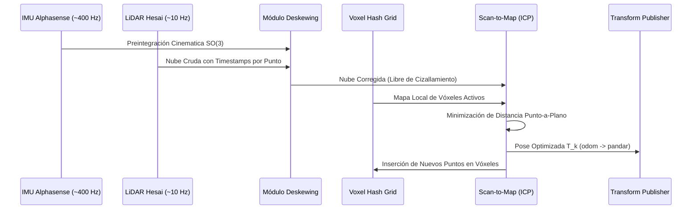
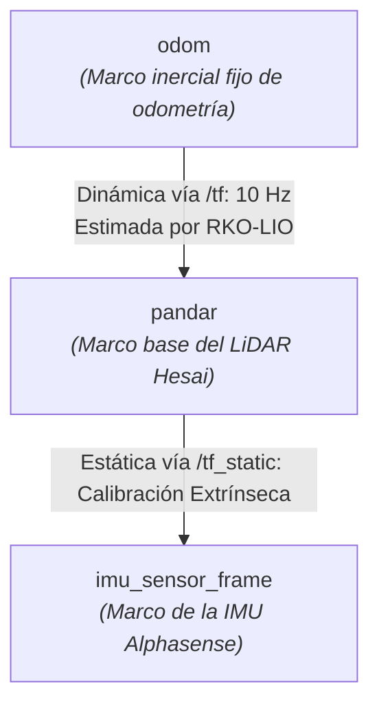

# Análisis Técnico del Pipeline LIO (Bloque 3)
## Odometría LiDAR-Inercial con Datos Reales (Oxford Spires Dataset y RKO-LIO)

---

## 1. Contexto y Objetivos del Bloque

El propósito del Bloque 3 es enfrentar al estudiante a los desafíos inherentes al procesamiento de flujos sensoriales masivos del **mundo real**, superando las condiciones ideales de los entornos de simulación (donde el tiempo simulado se detiene si la CPU se satura).

Para ello se emplea el framework **RKO-LIO** (*Robust Kinematic-based Odometry - LiDAR-Inertial Odometry*), ejecutado sobre secuencias reales del **Oxford Spires Dataset (OSD)** capturadas en el entorno arquitectónico urbano del *Keble College* (Oxford).

### Retos Fundamentales de los Datos Reales
1. **Densidad y Frecuencia Masiva:** El sensor LiDAR Hesai Pandar genera aproximadamente 30.000 puntos tridimensionales por barrido a 10 Hz, mientras que la unidad inercial (IMU Alphasense) publica aceleraciones y velocidades angulares a ~400 Hz.
2. **Distorsión por Movimiento (*Motion Deskewing*):** Debido al movimiento continuo del sensor durante el barrido angular del espejo del LiDAR, los puntos de un mismo fotograma se adquieren en instantes de tiempo ligeramente diferentes ($t_0 \dots t_0 + \Delta t$). Sin compensación cinemática intra-escaneo, la nube de puntos sufre cizallamiento y deformación métrica.
3. **Sensibilidad Temporal y Saturación:** La preintegración inercial exige que el intervalo temporal $\Delta t$ entre escaneos sea estrictamente regular. Si el procesador acumula latencia (cuello de botella de CPU), el estimador entra en retardo crítico y se ve forzado a descartar fotogramas (*dropping frames*), degradando la consistencia de la odometría.

---

## 2. Diagrama del Grafo Computacional (`rqt_graph`)

El flujo dinámico de tópicos entre los procesos del sistema se ilustra a continuación (disponible también en formato vectorial en [`diagramas/rqt_graph_rko_lio.pdf`](../diagramas/rqt_graph_rko_lio.pdf)):

```mermaid
flowchart LR
    subgraph Playback["Reproductor de Datos Reales"]
        bag["/rosbag2_player<br><i>(Oxford Spires Dataset)</i>"]
    end

    subgraph Estimador["Pipeline RKO-LIO"]
        lio["/rko_lio_online_node<br><i>(Estimador LiDAR-Inercial)</i>"]
    end

    subgraph Visualizacion["Monitorización Gráfica"]
        rviz["/rviz2<br><i>(Visualizador 3D)</i>"]
    end

    %% Tópicos de Entrada
    bag -->|/clock<br>rosgraph_msgs/Clock| lio
    bag -->|/alphasense_driver_ros/imu<br>sensor_msgs/Imu (~400 Hz)| lio
    bag -->|/hesai/pandar<br>sensor_msgs/PointCloud2 (~10 Hz)| lio

    %% Tópicos de Salida del Estimador
    lio -->|/rko_lio/odometry<br>nav_msgs/Odometry| rviz
    lio -->|/tf<br>tf2_msgs/TFMessage (odom -> pandar)| rviz
    lio -->|/rko_lio/local_map<br>sensor_msgs/PointCloud2| rviz
    lio -->|/rko_lio/deskewed_scan<br>sensor_msgs/PointCloud2| rviz
```

---

## 3. Mapeo Detallado de Nodos e Interfaces del Middleware

### 3.1. Tabla de Nodos Activos e Interfaces

| Nodo | Tópicos Suscritos (Inputs) | Tópicos Publicados (Outputs) | Servicios Ofrecidos | Acciones |
| :--- | :--- | :--- | :--- | :--- |
| `/rko_lio_online_node` | `/alphasense_driver_ros/imu`<br>`/hesai/pandar`<br>`/clock`<br>`/parameter_events` | `/rko_lio/odometry`<br>`/tf`<br>`/rko_lio/local_map`<br>`/rko_lio/deskewed_scan`<br>`/rko_lio/lidar_acceleration`<br>`/rosout`<br>`/parameter_events` | `/rko_lio_online_node/describe_parameters`<br>`/rko_lio_online_node/get_parameter_types`<br>`/rko_lio_online_node/get_parameters`<br>`/rko_lio_online_node/get_type_description`<br>`/rko_lio_online_node/list_parameters`<br>`/rko_lio_online_node/set_parameters`<br>`/rko_lio_online_node/set_parameters_atomically` | *(ninguna)* |
| `/rosbag2_player` | `/parameter_events` | `/alphasense_driver_ros/imu`<br>`/hesai/pandar`<br>`/alphasense_driver_ros/cam0/...`<br>`/alphasense_driver_ros/cam1/...`<br>`/alphasense_driver_ros/cam2/...`<br>`/clock`<br>`/rosout` | *(servicios estándar de parámetros)* | *(ninguna)* |
| `/rviz2` | `/tf`<br>`/tf_static`<br>`/rko_lio/odometry`<br>`/rko_lio/local_map`<br>`/rko_lio/deskewed_scan` | `/clicked_point`<br>`/initialpose`<br>`/goal_pose`<br>`/rosout` | *(servicios estándar de parámetros)* | *(ninguna)* |

### 3.2. Especificación de Tipos de Mensaje en Tópicos Clave

| Tópico | Tipo de Mensaje | Frecuencia Nominal | Propósito en el Pipeline |
| :--- | :--- | :--- | :--- |
| `/alphasense_driver_ros/imu` | `sensor_msgs/msg/Imu` | ~400 Hz | Aceleraciones lineales triaxiales ($\mathrm{m/s^2}$) y velocidades angulares ($\mathrm{rad/s}$) de alta frecuencia. |
| `/hesai/pandar` | `sensor_msgs/msg/PointCloud2` | ~10 Hz | Nube densa de puntos 3D cruda con campos `x, y, z, intensity, timestamp`. |
| `/rko_lio/odometry` | `nav_msgs/msg/Odometry` | ~10 Hz | Pose estimada (posición cartesiana y orientación en cuaternión) más matrices de covarianza y velocidades de traslación/rotación. |
| `/tf` | `tf2_msgs/msg/TFMessage` | ~10 Hz | Transformación dinámica espacial del marco origen de odometría al marco base (`odom -> pandar`). |
| `/rko_lio/local_map` | `sensor_msgs/msg/PointCloud2` | 1.0 Hz | Mapa acumulado de puntos voxelizados que sirve como referencia para el emparejamiento. |
| `/rko_lio/deskewed_scan` | `sensor_msgs/msg/PointCloud2` | ~10 Hz | Nube de puntos corregida geométricamente tras deshacer la distorsión del movimiento del sensor. |

---

## 4. Explicación Matemática y Sensorial del Pipeline

El pipeline RKO-LIO resuelve de manera conjunta la cinemática del robot mediante un esquema en cascada:



### 4.1. Preintegración Inercial en la Variedad de Lie $\mathrm{SO}(3)$
La IMU publica medidas discretas de velocidad angular $\tilde{\boldsymbol{\omega}}_t$ y aceleración lineal $\tilde{\mathbf{a}}_t$. Dado que la frecuencia de la IMU (400 Hz) es cuarenta veces superior a la del LiDAR (10 Hz), RKO-LIO integra las ecuaciones cinemáticas entre dos instantes de escaneo sucesivos $[t_k, t_{k+1}]$:
$$\Delta \mathbf{R}_{k,k+1} = \prod_{j=k}^{k+1} \exp\left( (\tilde{\boldsymbol{\omega}}_j - \mathbf{b}_j^\omega) \Delta t \right)$$
Esta integración produce una estimación a priori precisa de la rotación y la velocidad de traslación, sirviendo como condición inicial (*prior*) para el emparejamiento LiDAR y evitando que el optimizador caiga en mínimos locales.

### 4.2. Corrección de la Distorsión del Movimiento (*Deskewing*)
Cada punto $p_i$ de un escaneo contiene una estampa temporal $t_i \in [t_k, t_{k+1}]$. Con la trayectoria continua generada por la IMU, cada punto se interpola hacia la pose del marco base al final del barrido:
$$p_i^{\text{deskewed}} = \mathbf{T}_{t_i}^{-1} \mathbf{T}_{t_{k+1}} p_i$$
Esto elimina las aberraciones geométricas causadas por el avance del vehículo durante los 100 ms que dura una revolución del láser.

### 4.3. Estructura Espacial Voxel Hashing
Para acelerar la correspondencia de datos sin incurrir en árboles KD costosos, el mapa local se discretiza en una cuadrícula de vóxeles (*Voxel Grid*) con resolución:
- `voxel_size`: $1.0\ \mathrm{m}$
- `max_points_per_voxel`: $20$ puntos representativos por celda.
Los puntos redundantes se descartan, manteniendo acotada la memoria RAM y el tiempo de consulta a $O(1)$.

### 4.4. Scan-to-Map Matching e Iterative Closest Point (ICP)
La nube corregida se alinea con el mapa local mediante optimización no lineal iterativa (Gauss-Newton / Levenberg-Marquardt), minimizando la distancia métrica residual entre los puntos transformados y los planos de los vóxeles correspondientes:
$$\mathbf{T}^* = \arg\min_{\mathbf{T}} \sum_i \rho \left( \| \mathbf{T} p_i - q_i \|^2 \right)$$
con umbral de correspondencia `max_correspondance_distance = 0.5 m` y criterio de convergencia `convergence_criterion = 1.0e-5`.

---

## 5. Análisis e Interpretación del Árbol de Transformaciones (TF)

El árbol geométrico del Bloque 3 refleja la jerarquía espacial entre el marco inercial global, el sensor principal de localización y los sensores acoplados:

### 5.1. Jerarquía de Marcos Espaciales



### 5.2. Parámetros de Calibración Extrínseca (`oxford_spires.yaml`)

1. **LiDAR a Base (`extrinsic_lidar2base`):**
   - Marco de estimación asignado directamente al centro óptico del LiDAR: `base_frame = pandar`.
   - Traslación: $[0.0, 0.0, 0.0]\ \mathrm{m}$
   - Orientación (Cuaternión $[x, y, z, w]$): $[0.0, 0.0, 0.0, 1.0]$ (Identidad).
2. **IMU a Base (`extrinsic_imu2base`):**
   - Traslación: $[0.00152, -0.00468, -0.07758]\ \mathrm{m}$ (la IMU se sitúa aproximadamente a 7.7 cm por debajo de la base del escáner).
   - Orientación (Cuaternión $[x, y, z, w]$): $[0.00260, -0.00019, 0.71482, -0.69930]$ (rotación de aproximadamente $-90^\circ$ alrededor del eje $Z$ para alinear los ejes de medición angular con el LiDAR).

El diagrama oficial exportado se encuentra disponible en:
- Formato vectorial PDF: [`diagramas/frames_rko_lio.pdf`](../diagramas/frames_rko_lio.pdf)
- Código fuente Graphviz: [`diagramas/frames_rko_lio.gv`](../diagramas/frames_rko_lio.gv)
- Renderizado de imagen: [`diagramas/frames_rko_lio.png`](../diagramas/frames_rko_lio.png)

---

## 6. Comandos de Validación y Demostración en Laboratorio

Para reproducir el Bloque 3 durante la evaluación presencial frente al profesor:

```bash
# Terminal 1: Lanzar el estimador RKO-LIO con la configuración de Oxford Spires
docker exec -it --user developer robotica_inteligente_grado bash -c \
  "source /opt/ros/jazzy/setup.bash && ros2 launch rko_lio odometry.launch.py initialization_phase:=false rviz:=true config_file:=/home/developer/ros2_ws/oxford_spires.yaml use_sim_time:=true"

# Terminal 2: Reproducir el Rosbag de Keble College sincronizando el reloj
docker exec -it --user developer robotica_inteligente_grado bash -c \
  "source /opt/ros/jazzy/setup.bash && cd /home/developer/ros2_ws && ros2 bag play 1710255615_2024-03-12-15-00-16/ --clock"

# Terminal 3 (Introspección opcional durante la prueba):
docker exec -it --user developer robotica_inteligente_grado bash -c \
  "source /opt/ros/jazzy/setup.bash && ros2 topic hz /rko_lio/odometry && ros2 run tf2_tools view_frames"
```
