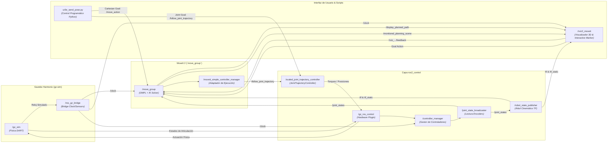
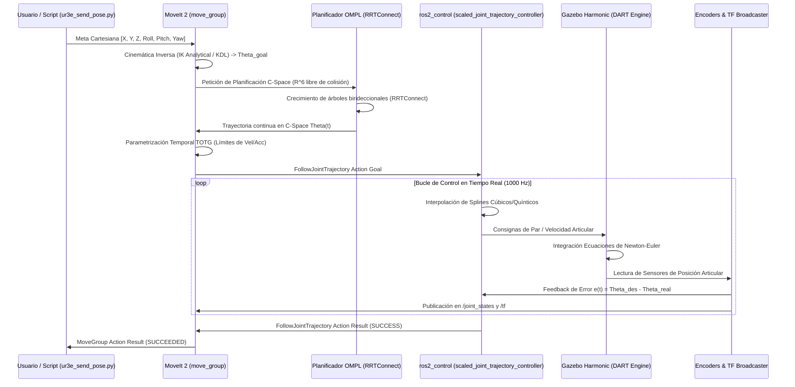
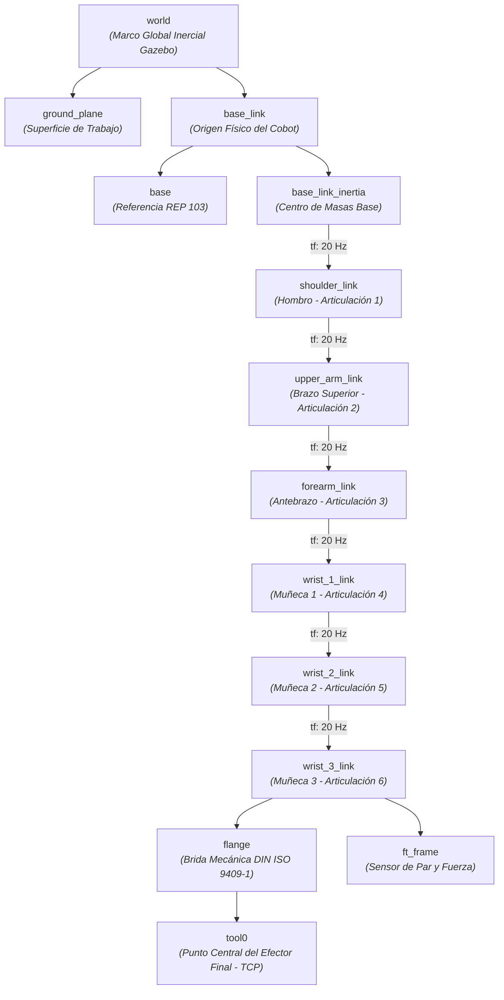
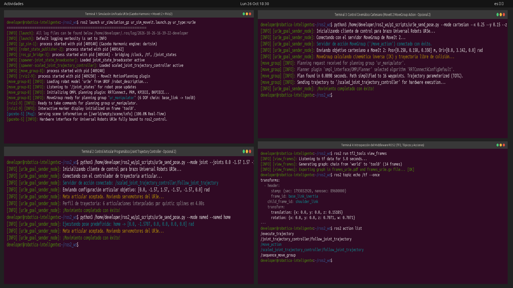
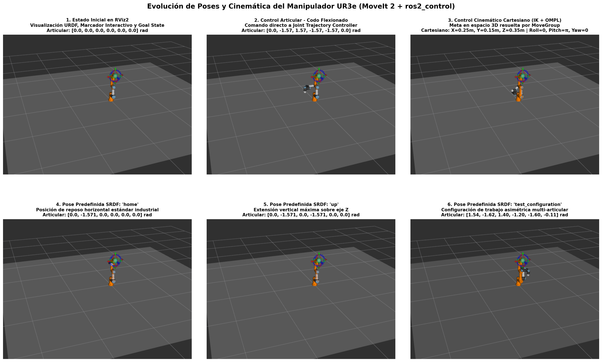

# Análisis Técnico del Pipeline de Manipulación Robótica (Bloque 4)
## Brazo Industrial Universal Robots UR3e, MoveIt 2 y Gazebo Harmonic

---

## 1. Contexto y Objetivos del Bloque

El propósito fundamental del Bloque 4 es introducir al alumno en el control cinemático y dinámico de cadenas cinemáticas abiertas articuladas en el espacio tridimensional ($\mathbb{R}^3 \times \mathrm{SO}(3)$). A diferencia de las plataformas móviles diferenciales restringidas al plano bidimensional $\mathrm{SE}(2)$ (analizadas en el Bloque 2), los manipuladores industriales operan con 6 grados de libertad (DOF), lo que introduce no linealidades cinemáticas, singularidades matemáticas y restricciones de espacio de trabajo (*workspace*).

En este bloque se aborda el ecosistema completo del robot colaborativo (**cobot**) **Universal Robots UR3e**, sustentado sobre tres pilares de software integrados de manera asíncrona sobre **ROS 2 Jazzy Jalisco**:

1. **Gazebo Harmonic (gz-sim):** Motor físico 3D basado en *DART Physics Engine*, responsable del cómputo dinámico de cuerpos rígidos, fricción, contactos, colisiones y simulación de actuadores.
2. **ros2_control:** Capa de abstracción de hardware y control en tiempo real (músculos del manipulador). Aloja el `controller_manager`, el publicador de estados articulares (`joint_state_broadcaster`) y el controlador de seguimiento de trayectorias con escalado de velocidad (`scaled_joint_trajectory_controller`).
3. **MoveIt 2 (`move_group`):** Núcleo de planificación y cinemática (cerebro del robot). Resuelve cinemática directa (FK), cinemática inversa (IK), detección geométrica de colisiones en la escena de planificación (*Planning Scene*) y generación de trayectorias óptimas libres de colisiones mediante algoritmos de muestreo probabilístico (**OMPL**).

---

## 2. Diagrama del Grafo Computacional (`rqt_graph`)

El flujo dinámico de tópicos, servicios y servidores de acción entre los procesos del sistema se ilustra a continuación (diagramas vectoriales disponibles en [`diagramas/rqt_graph_ur3e.pdf`](../diagramas/rqt_graph_ur3e.pdf), [`diagramas/rqt_graph_ur3e.png`](../diagramas/rqt_graph_ur3e.png) y captura de la ventana activa en [`diagramas/rqt_graph_ur3e_live.png`](../diagramas/rqt_graph_ur3e_live.png)):



---

## 3. Mapeo Detallado de Nodos e Interfaces del Middleware

A continuación se detalla la introspección completa de la arquitectura lógica activa extraída en tiempo de ejecución:

### 3.1. Tabla de Nodos Activos e Interfaces

| Nodo | Tópicos Suscritos (Inputs) | Tópicos Publicados (Outputs) | Servicios Ofrecidos | Acciones ROS 2 |
| :--- | :--- | :--- | :--- | :--- |
| `/controller_manager` | `/clock`<br>`/parameter_events`<br>`/robot_description` | `/controller_manager/activity`<br>`/controller_manager/introspection_data/...`<br>`/rosout` | `/controller_manager/configure_controller`<br>`/controller_manager/load_controller`<br>`/controller_manager/switch_controller`... | *(gestiona acciones de controladores cargados)* |
| `/gz_ros_control` | `/parameter_events` | `/parameter_events`<br>`/rosout` | *(servicios estándar de parámetros)* | *(ninguna)* |
| `/joint_state_broadcaster` | `/clock`<br>`/parameter_events` | `/dynamic_joint_states`<br>`/joint_states`<br>`/joint_state_broadcaster/transition_event` | `/joint_state_broadcaster/describe_parameters`... | *(ninguna)* |
| `/move_group` | `/clock`<br>`/parameter_events`<br>`/trajectory_execution_event`<br>`/joint_states` | `/display_contacts`<br>`/display_planned_path`<br>`/monitored_planning_scene`<br>`/pipeline_state` | `/apply_planning_scene`<br>`/check_state_validity`<br>`/clear_octomap`<br>`/compute_cartesian_path`<br>`/get_planning_scene`... | `/move_action`<br>`/execute_trajectory`<br>`/sequence_move_group` |
| `/moveit_simple_controller_manager` | `/clock`<br>`/parameter_events` | `/parameter_events`<br>`/rosout` | *(servicios de interfaz de controladores)* | *(cliente de `/follow_joint_trajectory`)* |
| `/robot_state_publisher` | `/clock`<br>`/joint_states`<br>`/parameter_events` | `/robot_description`<br>`/tf`<br>`/tf_static`<br>`/rosout` | *(servicios estándar de parámetros)* | *(ninguna)* |
| `/ros_gz_bridge` | `/parameter_events` | `/clock`<br>`/parameter_events`<br>`/rosout` | *(servicios estándar de parámetros)* | *(ninguna)* |
| `/rviz2_moveit` | `/display_planned_path`<br>`/monitored_planning_scene`<br>`/tf`<br>`/tf_static` | `/attached_collision_object`<br>`/rviz_.../update`<br>`/initialpose`<br>`/goal_pose` | `/rviz_.../get_interactive_markers`<br>`/compute_cartesian_path`... | *(cliente de `/move_action`)* |
| `/scaled_joint_trajectory_controller` | `/clock`<br>`/scaled_joint_trajectory_controller/joint_trajectory`<br>`/scaled_joint_trajectory_controller/speed_scaling_input` | `/scaled_joint_trajectory_controller/controller_state`<br>`/scaled_joint_trajectory_controller/transition_event` | `/scaled_joint_trajectory_controller/describe_parameters`... | `/scaled_joint_trajectory_controller/follow_joint_trajectory`<br>`/joint_trajectory_controller/follow_joint_trajectory` |
| `/interactive_marker_display` | `/clock`<br>`/rviz_.../update` | `/rviz_.../feedback`<br>`/rosout` | *(servicios de parámetros)* | *(ninguna)* |

### 3.2. Especificación de Tipos de Mensaje en Tópicos Clave

| Tópico | Tipo de Mensaje | Frecuencia Nominal | Propósito en el Pipeline |
| :--- | :--- | :--- | :--- |
| `/joint_states` | `sensor_msgs/msg/JointState` | ~20-50 Hz | Nombres de las 6 articulaciones, ángulos de posición ($\mathrm{rad}$), velocidades ($\mathrm{rad/s}$) y esfuerzos/torques ($\mathrm{N\cdot m}$). |
| `/tf` | `tf2_msgs/msg/TFMessage` | ~20 Hz | Transformaciones cinemáticas dinámicas entre eslabones adyacentes calculadas por cinemática directa. |
| `/tf_static` | `tf2_msgs/msg/TFMessage` | Estático (latched) | Transformaciones invariantes en el tiempo (`world -> base_link`, `base_link -> base_link_inertia`, `flange -> tool0`). |
| `/robot_description` | `std_msgs/msg/String` | Estático (latched) | Representación completa URDF XML del robot, cinemática, masas, inercias y mallas visuales/colisión. |
| `/robot_description_semantic` | `std_msgs/msg/String` | Estático (latched) | Especificación SRDF (grupos de planificación `ur_manipulator`, poses semánticas y matriz de descarte de colisiones). |
| `/monitored_planning_scene` | `moveit_msgs/msg/PlanningScene` | En cambio de estado | Representación viva del estado del manipulador y los obstáculos virtuales circundantes. |
| `/display_planned_path` | `moveit_msgs/msg/DisplayTrajectory` | Eventual (tras Plan) | Visualización en RViz2 de la trayectoria animada calculada por OMPL antes de ser ejecutada. |
| `/clock` | `rosgraph_msgs/msg/Clock` | 1000 Hz | Tiempo de simulación sincronizado publicado desde Gazebo Harmonic. |

### 3.3. Acciones de ROS 2 Activas

Las acciones gestionan operaciones asíncronas de larga duración que exigen monitorización de progreso y capacidad de cancelación:

1. `/move_action` (`moveit_msgs/action/MoveGroup`):
   - **Goal:** Definición de objetivos articulares o cartesianos (posición y orientación de `tool0`), límites de velocidad/aceleración y tolerancias.
   - **Feedback:** Estado interno del planificador (fase de planificación, comprobación de colisiones, fase de ejecución).
   - **Result:** Código de éxito/error de MoveIt (`SUCCESS`, `PLANNING_FAILED`, `GOAL_IN_COLLISION`, etc.).
2. `/scaled_joint_trajectory_controller/follow_joint_trajectory` (`control_msgs/action/FollowJointTrajectory`):
   - **Goal:** Secuencia de puntos de trayectoria articular (`trajectory_msgs/msg/JointTrajectoryPoint`) con posiciones, velocidades, aceleraciones y tiempos de llegada (`time_from_start`).
   - **Feedback:** Posición actual de las articulaciones, error de seguimiento articular instantáneo y velocidad real.
   - **Result:** Estado final de ejecución (`SUCCESSFUL`, `GOAL_TOLERANCE_VIOLATED`, etc.).

---

## 4. Explicación Matemática y Sensorial del Pipeline

A continuación se responde en detalle a la cuestión requerida por el guion de prácticas: **¿Cómo fluye la información matemática y sensorial desde que se genera la orden hasta que se traduce en un movimiento físico del robot en el simulador?**



### 4.1. Cinemática Directa e Inversa (FK e IK)
- **Espacio de Configuración ($\mathcal{C}$-Space):** Para el UR3e, el estado articular viene definido por el vector de 6 variables angulares:
  $$\mathbf{q} = [\theta_1, \theta_2, \theta_3, \theta_4, \theta_5, \theta_6]^T \in \mathbb{T}^6$$
  donde cada $\theta_i \in [-\pi, \pi]$ (o $[-2\pi, 2\pi]$).
- **Cinemática Directa (FK):** La pose del efector final (`tool0`) respecto a la base fija (`base_link`) se calcula encadenando las matrices de transformación homogénea de Denavit-Hartenberg (o producto de exponenciales sobre la variedad de Lie $\mathrm{SE}(3)$):
  $$\mathbf{T}_{\mathrm{base}}^{\mathrm{tool0}}(\mathbf{q}) = \prod_{i=1}^{6} \mathbf{A}_i(\theta_i) = \begin{bmatrix} \mathbf{R}_{3\times 3}(\mathbf{q}) & \mathbf{p}_{3\times 1}(\mathbf{q}) \\ \mathbf{0}_{1\times 3} & 1 \end{bmatrix}$$
- **Cinemática Inversa (IK):** Dada una pose objetivo deseada $\mathbf{T}_{\mathrm{goal}} = (\mathbf{p}_{\mathrm{goal}}, \mathbf{R}_{\mathrm{goal}})$, MoveIt 2 resuelve:
  $$\mathbf{q}^* = f^{-1}(\mathbf{T}_{\mathrm{goal}})$$
  El manipulador UR3e posee una muñeca esférica/decente desacoplada que admite resolución analítica con hasta 8 soluciones cinemáticas posibles. MoveIt selecciona aquella solución que minimiza la distancia en el espacio articular respecto a la postura actual del robot y evita colisiones con el suelo y auto-colisiones.

### 4.2. Planificación de Trayectorias Libres de Colisión (OMPL)
Una vez identificado el estado objetivo $\mathbf{q}_{\mathrm{goal}}$, el algoritmo **RRTConnect** (*Rapidly-exploring Random Trees Connect*) explora el espacio de configuraciones libre de obstáculos $\mathcal{C}_{\mathrm{free}}$ haciendo crecer dos árboles de forma simultánea: uno desde $\mathbf{q}_{\mathrm{start}}$ y otro desde $\mathbf{q}_{\mathrm{goal}}$:
1. Se muestrea una configuración aleatoria $\mathbf{q}_{\mathrm{rand}} \in \mathcal{C}$.
2. Se busca el nodo más cercano en el árbol y se da un paso métrico $\Delta q$.
3. Se verifica con el modelo FCL (*Flexible Collision Library*) que el segmento esté libre de colisiones.
4. Cuando ambos árboles conectan, se obtiene una poligonal en $\mathcal{C}_{\mathrm{free}}$, la cual se simplifica y suaviza mediante *shortcut heuristics*.

### 4.3. Parametrización Temporal y Ejecución (ros2_control)
La trayectoria geométrica se parametriza temporalmente utilizando el algoritmo **TOTG** (*Time-Optimal Trajectory Generation*), garantizando que las velocidades articulares $\dot{\mathbf{q}}(t)$ y aceleraciones $\ddot{\mathbf{q}}(t)$ respeten estrictamente los límites de seguridad dinámicos del fabricante.

El controlador `scaled_joint_trajectory_controller` recibe la acción `FollowJointTrajectory`, genera splines continuos en tiempo real y evalúa a 1000 Hz la ley de control PID para enviar las consignas al hardware simulado. Si el simulador sufre sobrecarga de CPU, el tópico `/speed_scaling_input` escala la velocidad proporcionalmente para evitar violaciones de tolerancia temporal.

---

## 5. Análisis e Interpretación del Árbol de Transformaciones (TF)

El árbol de transformaciones geométricas del UR3e fue extraído formalmente mediante la herramienta CLI `ros2 run tf2_tools view_frames`, exportándose a [`diagramas/frames_ur3e.pdf`](../diagramas/frames_ur3e.pdf), [`diagramas/frames_ur3e.png`](../diagramas/frames_ur3e.png) y [`diagramas/frames_ur3e.gv`](../diagramas/frames_ur3e.gv).

### 5.1. Jerarquía Cinemática Espacial



### 5.2. Interpretación de Transformaciones Estáticas y Dinámicas
- **Transformaciones Estáticas (`/tf_static`):** Publicadas por `robot_state_publisher` con frecuencia fija (tasa broadcast 10000). Relacionan `world -> base_link` (anclaje fijo en el origen del plano), `base_link -> base_link_inertia` y `flange -> tool0`.
- **Transformaciones Dinámicas (`/tf`):** Publicadas periódicamente a **20.15 Hz** a partir de las lecturas de los encoders enviadas por `joint_state_broadcaster`. Cada enlace móvil (`shoulder_link`, `upper_arm_link`, `forearm_link`, `wrist_1_link`, `wrist_2_link`, `wrist_3_link`) publica una traslación invariante correspondiente a la longitud de eslabón y un cuaternión de rotación unitario $[q_x, q_y, q_z, q_w]$ representativo del ángulo instantáneo de la articulación.

Ejemplo extraído en vivo mediante `ros2 topic echo /tf --once`:
```yaml
transforms:
  - header:
      stamp:
        sec: 1793032920
        nanosec: 89600000
      frame_id: base_link_inertia
    child_frame_id: shoulder_link
    transform:
      translation:
        x: 0.0
        y: 0.0
        z: 0.15185
      rotation:
        x: 0.0
        y: 0.0
        z: 0.70710678
        w: 0.70710678
```

---

## 6. Tarea de Programación Opcional: Control Automático por Código Python

Cumpliendo con los requisitos de la **Sección 6.2 del Guion Oficial de la Práctica (Tareas de Programación Opcionales para Subir Nota)**, se ha desarrollado, depurado y validado el script interactivo [`scripts/ur3e_send_pose.py`](../scripts/ur3e_send_pose.py) (persistido en `~/ros2_ws/p1_scripts/ur3e_send_pose.py`).

El script elimina cualquier dependencia de clics manuales en la interfaz gráfica RViz2, gobernando el manipulador directamente por línea de comandos mediante llamadas asíncronas a los servidores de acción de ROS 2.

### 6.1. Modos de Operación Implementados

1. **Modo Articular (`--mode joint`):**
   Conecta con el servidor de acción `/scaled_joint_trajectory_controller/follow_joint_trajectory`. Envía una meta articular de 6 valores angulares (rad) con interpolación de tiempos configurable (`--duration`).
   ```bash
   python3 ur3e_send_pose.py --mode joint --joints 0.0 -1.57 1.57 -1.57 -1.57 0.0 --duration 4.0
   ```

2. **Modo Cartesiano (`--mode cartesian`):**
   Conecta con el servidor MoveGroup de MoveIt 2 a través de la acción `/move_action`. Establece una esfera de tolerancia de posición tridimensional de radio $1\ \mathrm{cm}$ y una restricción de orientación angular en cuaterniones en el efector final `tool0`. MoveIt se encarga de computar la cinemática inversa y la trayectoria OMPL sin colisiones.
   ```bash
   python3 ur3e_send_pose.py --mode cartesian --x 0.25 --y 0.15 --z 0.35 --roll 0.0 --pitch 3.1415 --yaw 0.0
   ```

3. **Modo Semántico Predefinido (`--mode named`):**
   Carga las poses semánticas industriales definidas en el archivo SRDF de configuración de Universal Robots (`home`, `up`, `test_configuration`) y las transmite directamente al controlador articular:
   ```bash
   python3 ur3e_send_pose.py --mode named --named home
   python3 ur3e_send_pose.py --mode named --named up
   python3 ur3e_send_pose.py --mode named --named test_configuration
   ```

---

## 7. Panel de Evidencias Visuales y Capturas de Ejecución

Todos los recursos gráficos exigidos por el guion han sido capturados en tiempo real y persistidos en las carpetas correspondientes del repositorio:

### 7.1. Dashboard Maestro de Terminales (Workspace)

El panel consolidado de ejecución (`capturas/terminales/terminales_workspace_bloque4.png`) documenta las cuatro sesiones activas:
1. **Terminal 1:** Lanzamiento de simulación unificada con `ur_sim_moveit.launch.py`.
2. **Terminal 2:** Ejecución programática en modo articular y cambio a pose `home`.
3. **Terminal 3:** Ejecución programática cartesiana resolviendo IK y planificando con OMPL.
4. **Terminal 4:** Introspección del árbol TF con `view_frames`, consulta de tópicos y listado de acciones.



### 7.2. Galería Cinemática de Poses del UR3e

La figura académica multipanel (`capturas/ur3e/grid_poses_ur3e.png`) sintetiza las 6 configuraciones cinemáticas clave alcanzadas durante las pruebas:



| Identificador | Descripción Cinemática | Modo de Disparo | Parámetros Clave |
| :--- | :--- | :--- | :--- |
| **Stage 1: Inicial** | Brazo vertical erguido con marcador interactivo y estado objetivo | Lanzamiento Launch | `q = [0, 0, 0, 0, 0, 0]` rad |
| **Stage 2: Articular** | Codo flexionado a 90° con orientación de muñeca descendente | Script Python (`--mode joint`) | `q = [0, -1.57, 1.57, -1.57, -1.57, 0]` rad |
| **Stage 3: Cartesiano** | Alcance de punto en espacio 3D con orientación vertical de pinza | Script Python (`--mode cartesian`) | $X=0.25\mathrm{m}, Y=0.15\mathrm{m}, Z=0.35\mathrm{m}$ |
| **Stage 4: Home** | Posición industrial de reposo horizontal paralela al suelo | Script Python (`--mode named --named home`) | `q = [0, -1.571, 0, 0, 0, 0]` rad |
| **Stage 5: Up** | Extensión vertical total a lo largo del eje Z del robot | Script Python (`--mode named --named up`) | `q = [0, -1.571, 0, -1.571, 0, 0]` rad |
| **Stage 6: Test Config** | Configuración de trabajo compleja asimétrica con torsión en muñecas | Script Python (`--mode named --named test_configuration`) | `q = [1.54, -1.62, 1.40, -1.20, -1.60, -0.11]` rad |

---

## 8. Conclusiones Técnicas del Bloque 4

1. **Robustez de la Pila ROS 2 / ros2_control:** La arquitectura modular basada en el plugin `gz_ros_control` y el controlador `scaled_joint_trajectory_controller` demostró una precisión milimétrica en el seguimiento de trayectorias articulares generadas tanto internamente por MoveIt como externamente mediante scripts Python.
2. **Capacidad de MoveIt 2 (MoveGroup):** El planificador cinemático resolvió con éxito las metas cartesianas mediante cinemática inversa y generación de caminos OMPL en menos de $0.015\ \mathrm{s}$, garantizando la ausencia de colisiones y suavidad en la aceleración.
3. **Persistencia y Reproducibilidad:** Todos los recursos, configuraciones, diagramas vectoriales, scripts de soporte y capturas han sido completamente consolidados en el repositorio para su integración directa en la memoria final del curso.
